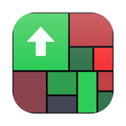

# Stockmote

[English](README.md) · **Dansk**

En menubar-app til macOS der viser aktiemarkedet som et heatmap: tre amerikanske indekser og ti europæiske, fra S&P
500 til danske C25 og tyske DAX — og enhver ETF eller indeksfond du søger frem, vist aktie for aktie.

**Denne app er skrevet af en maskinintelligens.** Al koden, kommentarerne, designet, ikonet, scripts og denne README
er lavet af Claude Opus 5.5 (Anthropic) ud fra et menneskes beskrivelse. Intet menneske har gennemgået koden linje for
linje. Læs [Ansvarsfraskrivelsen](#ansvarsfraskrivelse) før du stoler på den med noget.

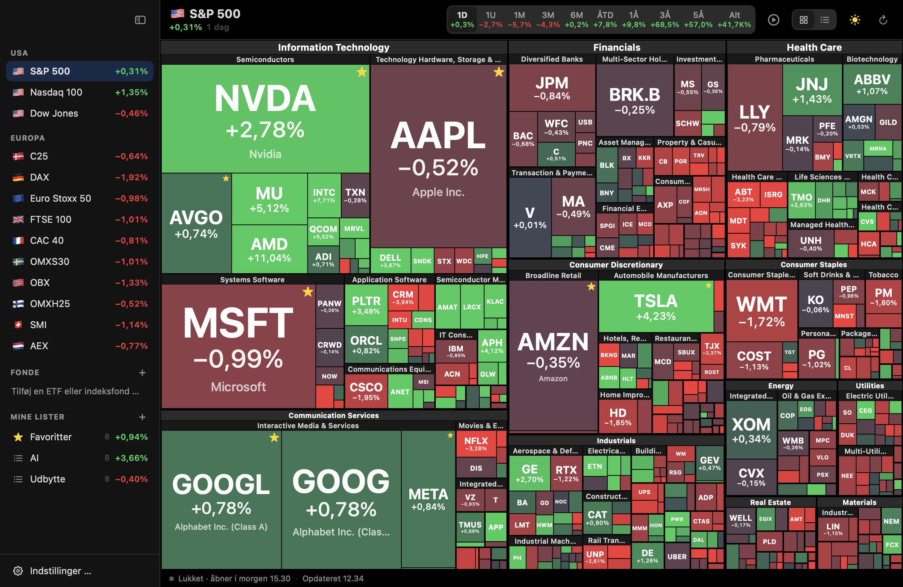

Den lever i menubaren: intet dock-ikon, intet vindue. Klik på ikonet, og panelet folder sig ud. Hvert felt er et
selskab; størrelsen er markedsværdien, og farven er hvor meget aktien har bevæget sig i det tidsrum du har valgt.
Markeder og dine egne lister står i en sidebjælke til venstre, hver med sin ændring lige ved siden af.

Appen taler dansk og engelsk.

Kun Apples egne frameworks: SwiftUI, AppKit, WidgetKit og AppIntents. Ingen tredjepartsafhængigheder. Kræver macOS 14
eller nyere.

## Ansvarsfraskrivelse

Ikke investeringsrådgivning. Appen viser offentlige kurser som de er. Den er ikke lavet af eller forbundet med Nasdaq,
Yahoo, S&P Dow Jones Indices, Nasdaq Copenhagen, Deutsche Börse, BlackRock, State Street, Invesco eller nogen anden børs,
indeks- eller fondsudbyder.

Kurserne kommer fra offentlige adresser hos Yahoo Finance og Nasdaq, fondenes beholdninger fra BlackRock (iShares),
State Street og Invesco, alle uden konto eller API-nøgle. Ingen af
dem er et dokumenteret, lovet API. De kan alle ændre sig eller lukke uden varsel; så bliver kortet gråt, og
statuslinjen siger hvilken kilde der fejlede. Ingen analytics og ingen sporing.

## Funktioner

- **13 indekser.** USA: S&P 500, Nasdaq 100, Dow Jones. Europa: 🇩🇰 C25, 🇩🇪 DAX, 🇪🇺 Euro Stoxx 50, 🇬🇧 FTSE 100,
  🇫🇷 CAC 40, 🇸🇪 OMXS30, 🇳🇴 OBX, 🇫🇮 OMXH25, 🇨🇭 SMI og 🇳🇱 AEX. ⌘1 … ⌘9 hopper til de første ni.
- **Fonde.** + ved **Fonde** i sidebjælken åbner en dialog midt i panelet: skriv navn eller ticker på en ETF eller
  indeksfond (`SPY`, `SEC0`, `iShares Core MSCI World`, `SPIC25`) og vælg et resultat. Beholdningen hentes med det
  samme, med en smagsprøve som "237 aktier · største: Taiwan Semiconductor 8,81%", og kun en fond hvis beholdning
  kunne findes, kan tilføjes — ellers siger dialogen det, og **Tilføj** forbliver slået fra. Retur tilføjer og åbner
  den; Esc annullerer uden at lukke panelet. Fonden vises
  præcis som et indeks — sektor → branche → aktie, zoom, hover, liste, afspilning, fuld skærm, widget — men hvert
  felts størrelse er aktiens **vægt i fonden**, ikke dens markedsværdi. Titlen viser fondens eget navn og dens egen
  kursændring. Hover viser vægten, listen har en vægt-kolonne, og statuslinjen siger hvor beholdningen kommer fra.
  Store fonde (iShares Core MSCI World: ~1200 aktier) beskæres til de 500 største efter vægt, og det står i
  statuslinjen.
  Fondene huskes på tværs af genstart; højreklik for at hente beholdningen igen eller fjerne fonden.
- **Seks tidsrum** i den segmenterede kontrol øverst: 1D, 1U, 1M, 3M, ÅTD og 1Å. Farveskalaen følger tidsrummet: fuld
  farve ved ±3 % for en dag, ±35 % for et år.
- **Sektorer og brancher.** Klik på en sektor- eller branchestrimmel for at gå ind i den. Titlen bliver det niveau,
  med en tilbagepil og vejen op nedenunder (`🇩🇰 C25 › Health Care`), som man kan klikke på; Esc gør det samme. Et
  klik på det valgte indeks i sidebjælken fører også tilbage til hele kortet.
- **Zoom.** Knib på trackpad'en (eller ⌘-scroll) for at zoome der hvor markøren er; to-finger-scroll eller træk for
  at flytte rundt. Små felter får navn efterhånden som de vokser.
- **Afspil dagen** (▶ i værktøjslinjen eller ⌘P): kortet animeret gennem tidsrummet — handelsdagen i 5-minutters
  skridt, en uge i halve timer, måneder dag for dag, et år uge for uge. Under kortet løber indeksets kurve; træk i
  den for at hoppe til et tidspunkt, eller brug mellemrum til afspil/pause og ← → til at gå et skridt. Titlen,
  farverne og kursen i tooltippen følger det viste tidspunkt. 1×, 2× eller 4× hastighed. Felternes størrelse står
  fast; kun farverne bevæger sig. I fuld skærm kører den i ring, som et levende billede af markedet.
- **Fuld skærm** (⌃⌘F eller ⤢-knappen): kortet alene, kant til kant, uden dock, titel eller ramme; menubaren
  skjules og glider kun frem hvis man fører musen helt op. Hover, klik og zoom virker stadig. Esc zoomer først ud,
  går så et niveau op og lukker til sidst. ⌃⌘F, menubar-ikonet eller **Afslut fuld skærm** i højrekliksmenuen
  lukker med det samme. På en MacBook med notch starter kortet under notchen, og båndet ved siden af viser titel,
  ændring og afspilningens klokkeslæt.
- **Hold musen over** et felt for kurs (i aktiens egen valuta), markedsværdi, sektor, branche og ændring.
- **Klik** på et felt for at åbne aktien i browseren (Yahoo Finance, Google Finance, Nasdaq eller Finviz).
  **Højreklik** for at føje den til favoritter eller en watchliste, hoppe til dens sektor eller branche eller kopiere
  symbolet.
- **Favoritter** og **watchlister** i sidebjælken under **Mine lister**, hver med et søgefelt der finder enhver
  amerikansk aktie og enhver aktie i de europæiske indekser. Favoritter får en lille stjerne på kortet. + laver en ny
  watchliste, og højreklik → **Omdøb …** omdøber en, begge i en lille dialog over panelet; højreklik for at slette en.
- **Listevisning** (⌘L): ethvert kort som en sortérbar liste.
- **Lyst og mørkt tema.** Det lyse er ikke det mørke vendt om: hvide fuger mellem felterne, lysegrå for uændrede
  aktier og mørk tekst hvor et felt er lyst.
- **Dansk eller engelsk**, skiftet med det samme uden genstart. Tallene følger med: `+0,31%` og `1,2 bio. $` på
  dansk, `+0.31%` og `$1.2T` på engelsk.
- **Menubaren** viser det valgte indeks' ændring i dag ved siden af ikonet, begge i grønt eller rødt (eller
  blåt/orange).
- **Widget** til skrivebordet og Notifikationscenter i alle fire størrelser: favoritter, en watchliste eller et
  indeks, en fond, en sektor eller en branche, i ethvert tidsrum. Den følger temaet fra indstillingerne (som systemet, lyst eller mørkt). Et klik åbner panelet på
  den rigtige visning.
- **Alt der slår til, slår også fra** med samme klik eller tast: menubar-ikonet lukker panelet (og fuld skærm),
  Indstillinger går tilbage til hvor du var, ⌘0 sidebjælken, ⌘L kort/liste, ⌃⌘F fuld skærm, og et klik på et
  søgeforslag der allerede er på listen (✓) fjerner det.
- **Smalle paneler.** I den lille størrelse forkortes lange titler med …, og tidsvælgeren bliver en kompakt menu, så
  intet skubbes ud af vinduet.
- **Indstillinger:** tema, farver (rød/grøn eller orange/blå ved rød-grøn farveblindhed), panelstørrelse, sprog, hvad
  menubaren viser, start ved login, feltstørrelse i lister, opdateringsfrekvens, hvilken side og browser aktier åbnes
  i.

| | |
| --- | --- |
| 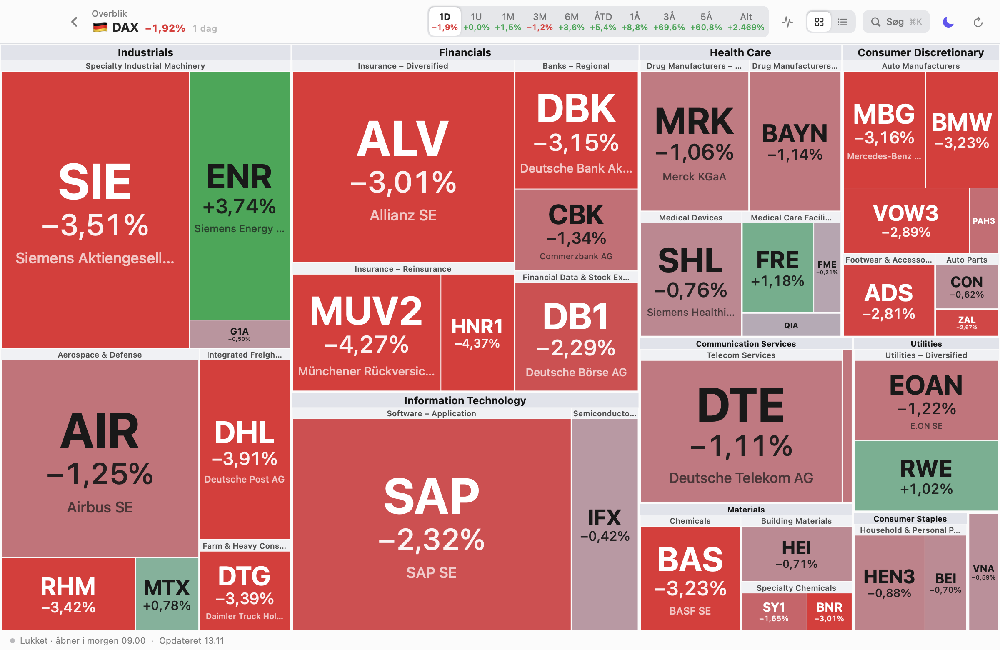 | 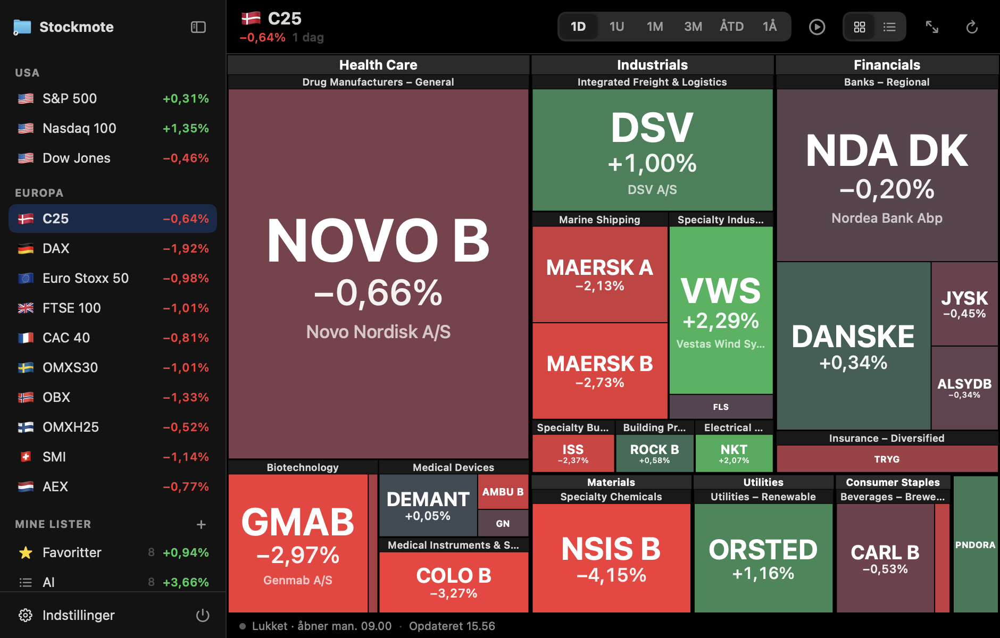 |
| DAX, lyst tema | C25 — danske aktier i danske kroner |
| 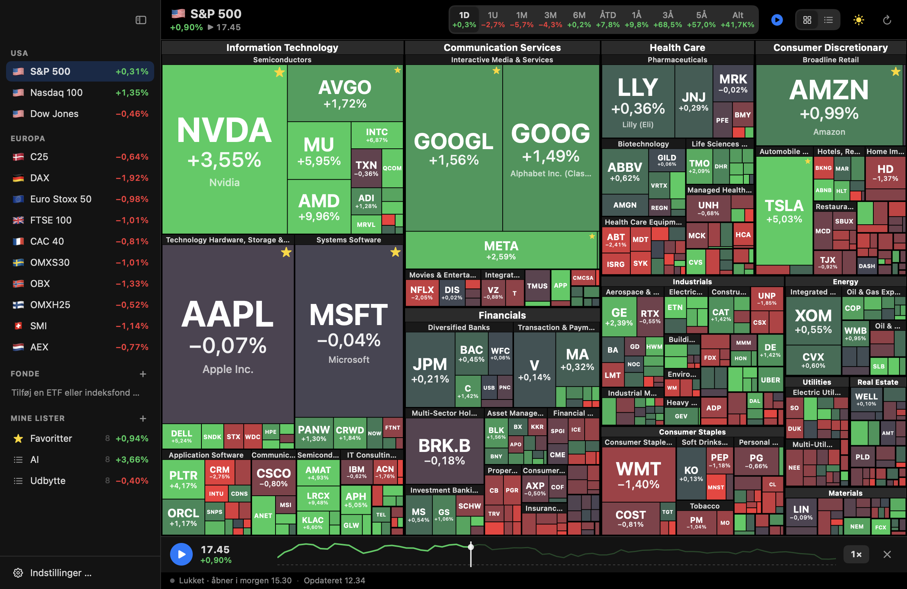 | 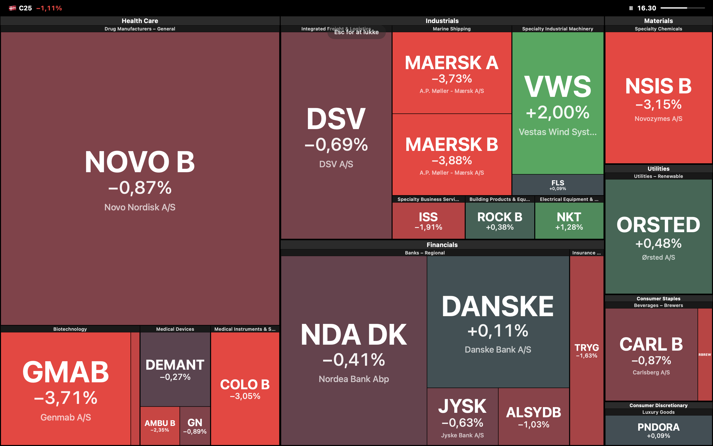 |
| S&P 500's dag afspillet, sat på pause kl. 17.45 | Fuld skærm med notch: C25 afspillet til kl. 14.30 |
| 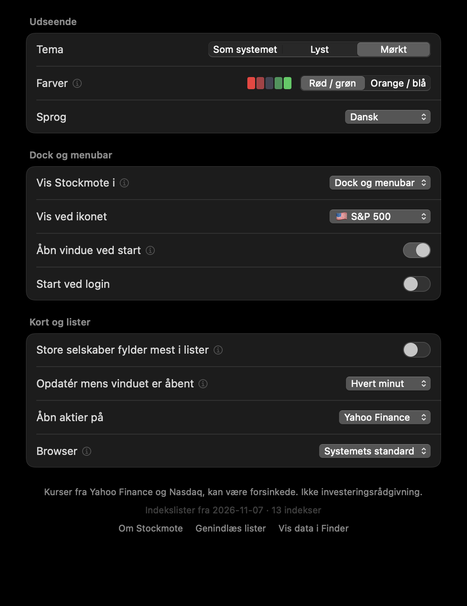 | 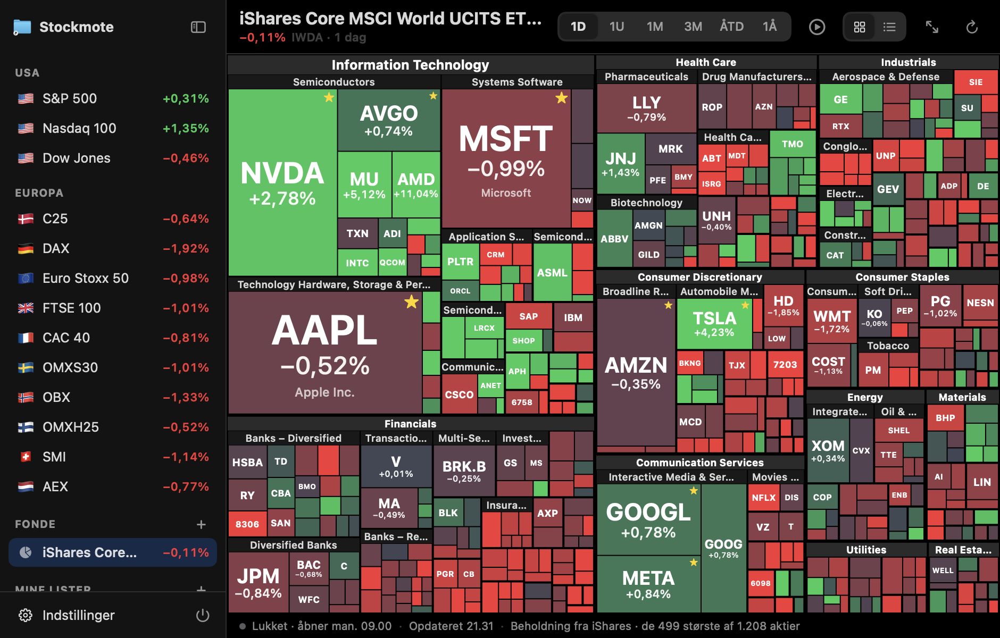 |
| Indstillinger i den mindste panelstørrelse | En fond: iShares Core MSCI World, felter efter vægt |
| 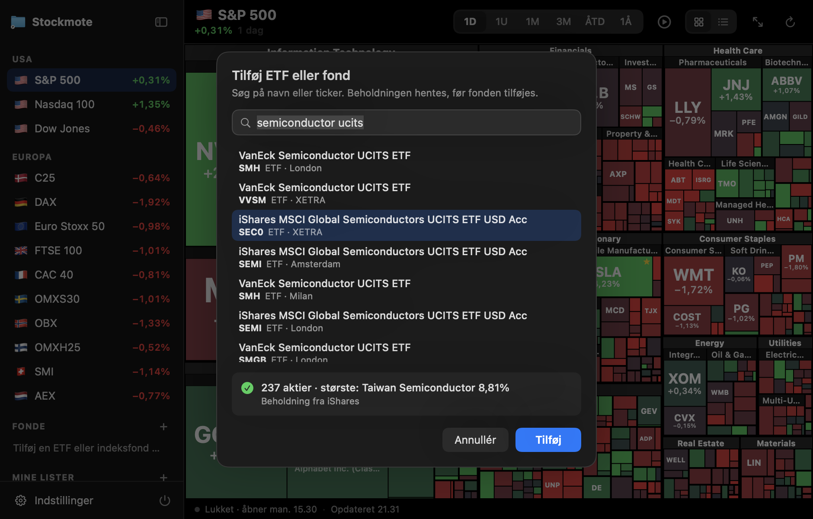 | |
| En fond tilføjes: beholdningen tjekkes, før den kan tilføjes | |

## Byg

```bash
swift build
swift run Stockmote
```

## Lav .app-bundlen

```bash
./Scripts/make-app.sh --install --open
```

Bygger release, pakker `build/Stockmote.app` med widget'en indeni som `Contents/PlugIns/StockmoteWidget.appex`,
signerer begge ad hoc og kopierer med `--install` appen til `/Applications` (en kørende kopi lukkes først).

Widget'en dukker op i galleriet når appen ligger i `/Applications` og har været åbnet én gang: højreklik på
skrivebordet → **Rediger widgets** → søg efter Stockmote.

## Hvor data kommer fra

| Hvad | Kilde | Hvor tit |
| --- | --- | --- |
| Kurs og ændring, alle tidsrum, alle indekser | Yahoo Finance `v7/finance/spark` | Hvert minut mens panelet er åbent og en børs er åben; ellers hvert 5. minut; hver halve time når alle er lukket |
| Forløb til afspilning | Samme adresse med `interval` sat (5m, 30m, 1d eller 1wk) | Når du starter en afspilning, og igen hvis du skifter indeks, liste eller tidsrum |
| Valutakurser (til at give europæiske aktier størrelse i dollar) | Yahoo Finance, `EURUSD=X` m.fl. | Sammen med kurserne |
| Amerikansk markedsværdi, navn, søgning | Nasdaq's screener (alle ~7000 amerikanske aktier, 2 MB) | Hver halve time |
| Indeksmedlemmer, sektorer, europæiske markedsværdier | `Indices.json`, bundtet med | Når du kører `update-indices.sh` |
| Søgning efter fonde; sektor for udenlandske aktier i fonde | Yahoo Finance `v1/finance/search` | Når du skriver; for hver ny aktie én gang |
| Fondes beholdning: iShares-ETF'er, amerikanske og europæiske (SOXX, IVV, SEC0, EUNL, CSPX …) | iShares' produktlister (dem produktsøgningen på ishares.com henter, for det amerikanske, britiske og tyske site) og hver fonds `latest-holdings.csv` | Når fonden tilføjes, og derefter højst ugentligt; produktlisterne ugentligt |
| Fondes beholdning: SPDR-ETF'er (SPY, XLK, SPGM …) | State Streets daglige regneark (`holdings-daily-us-en-<ticker>.xlsx`) | Når fonden tilføjes, og derefter højst ugentligt |
| Fondes beholdning: Invesco-ETF'er (QQQ, RSP …) | Invescos JSON (`dng-api.invesco.com`) | Som ovenfor |

**Nasdaq's screener halter.** Målt en fredag eftermiddag viste den stadig torsdagens lukkekurs, så den bruges kun til
størrelse og søgning, og markedsværdien skaleres med Yahoo's aktuelle kurs. Yahoo tillader 20 symboler pr. kald, så
S&P 500 koster 26 kald, fire ad gangen.

**Europæiske markedsværdier** kommer fra Yahoo's fundamentals-tidsserie i lokal valuta, gemt sammen med kursen på det
tidspunkt. Appen skalerer dem med dagens kurs og omregner til dollar, så en watchliste med både Novo Nordisk og Apple
får rimelige størrelser.

**Indekstallet** øverst og i sidebjælken er indeksets eget (`^GSPC`, `^OMXC25`, `^GDAXI` …). Svarer Yahoo ikke, bruges
et gennemsnit af medlemmerne vægtet efter markedsværdi — tæt på, men ikke det officielle tal.

**Felterne har størrelse efter markedsværdi i alle indekser.** Det rigtige Dow Jones er prisvægtet, men et kort hvor
størrelsen er aktiekursen siger ikke meget.

**Sektorer.** Amerikanske aktier bruger GICS. Europæiske bruger Yahoo's klassifikation, oversat til GICS'
sektornavne, så alle indekser deler sprog; brancherne beholder Yahoo's navne (`Drug Manufacturers – General`).

**Fonde.** Ingen åben kilde har beholdningen for alle fonde. Appen prøver i denne rækkefølge:

1. **Fondens egen beholdning** hos iShares (amerikanske og europæiske iShares-ETF'er), State Street (alle
   SPDR-ETF'er) eller Invesco. En iShares-fond findes i iShares' egne produktlister på ticker — enhver notering:
   `SEC0` på Xetra, `SEMI` i London — eller ellers på navnet, for listerne har én ticker pr. land (`IWDA` i Amsterdam
   findes som "iShares Core MSCI World UCITS ETF", samme fond som `SWDA` og `EUNL`). Alle tre lægger hele
   beholdningen frem, med vægt, ticker og handelsvaluta; iShares også med børs og sektor.
2. **Et af appens egne indekser**, hvis fondens navn siger at den følger det: `iShares Core DAX`, `Sparindex INDEX OMX
   C25 KL`, `Vanguard 500 Index Admiral`. Så er beholdningen indeksets medlemmer, og felterne får markedsværdi.
3. **En SPDR-fond på et tilsvarende indeks**: MSCI World, MSCI ACWI og FTSE All-World → SPGM (MSCI ACWI IMI);
   emerging markets → SPEM; Europa/STOXX 600 → SPEU; hele det amerikanske marked → SPTM. Statuslinjen siger det
   ("Beholdning fra SPGM (SSGA), der følger et tilsvarende indeks"). MSCI World har ikke emerging markets med, så det
   er en tilnærmelse — de største aktier er de samme.
4. Ellers: "Kunne ikke hente beholdningen for …".

Fonde med en drejning i navnet — sektor, faktor, ESG, gearing, obligationer — følger ikke det brede indeks og får
ingen erstatning. Vanguard, Zacks og stockanalysis.com blev prøvet og fravalgt: de afviser alt andet end en browser.

Udenlandske aktier i en fond får Yahoo-symbol ud fra ticker og børs, når udbyderen skriver børsen, som iShares gør
(`ASML` på Euronext Amsterdam → `ASML.AS`, `000660` på Korea Exchange → `000660.KS`), og ellers ud fra ticker og
valuta (`7203` + JPY → `7203.T`, `700` + HKD → `0700.HK`, `SHEL` + GBP → `SHEL.L`). Euro-aktier uden børs kan ikke
gættes (Paris, Frankfurt, Milano …) og slås op på navnet, og det gør aktier hvis gættede symbol Yahoo ikke kender,
også (iShares skriver Roche som `ROP`; Yahoo har `ROG.SW`). Sektor og branche kommer fra `Indices.json` hvis aktien
står der, ellers fra Yahoo's søgning, oversat til GICS' sektornavne, og som sidste udvej fra fondens egen fil.
Opslagene gemmes i `~/Library/Application Support/Stockmote/Funds/Names.json`, iShares' produktlister i
`iShares.json` og beholdningerne i samme mappe, så en fond kun koster Yahoo-kald første gang. Yahoo svarer 429 hvis der spørges for meget; så ventes der, og
de opslag der fejlede, prøves igen ét ad gangen.

**Åbningstider** følger hver børs og vises i din lokale tid i statuslinjen: `Lukket · åbner man. 09.00`. Helligdage
kendes ikke.

## Indeksmedlemmer

```bash
./Scripts/update-indices.sh          # skriv Indices.json igen
./Scripts/update-indices.sh --check  # vis hvad der er ændret, skriv intet
```

Scriptet ([update-indices.py](Scripts/update-indices.py)) tager omkring et minut:

- **S&P 500** fra listen `datasets/s-and-p-500-companies` med GICS-sektor og -branche.
- **Nasdaq 100** fra Nasdaq's egen liste. Medlemmer uden for S&P 500 (ASML, Arm, Shopify …) har ingen åben
  GICS-kilde og står i `OVERRIDES`.
- **Dow Jones** fra Wikipedias skabelon over medlemmerne.
- **De ti europæiske indekser** fra tickertabellen i hver Wikipedia-artikel. Sektor, navn og markedsværdi kommer fra
  to Yahoo-adresser der ikke kræver cookie: søgningen og fundamentals-tidsserien. Tickers hvor Wikipedia og Yahoo er
  uenige, står i `YAHOO_RENAMES` (Nordea hedder `NDA-DK.CO`).

Yahoo svarer 429 hvis man kører scriptet flere gange i træk. Det venter og prøver igen; fejler det stadig, stopper det
før det skriver, så den gamle fil er urørt.

Du kan overstyre den bundtede fil uden at bygge: læg din egen `Indices.json` i
`~/Library/Application Support/Stockmote/` og klik **Genindlæs lister** i indstillingerne.

## Widget'en

Tre ting som Xcode normalt gør for en widget, måtte gøres i hånden, fordi appen bygges med SwiftPM:

- **Startpunkt.** En udvidelse skal starte i Foundations `_NSExtensionMain`, ikke i `main`. Uden det dør processen i
  ExtensionFoundation før WidgetKit når at starte, og widget'en dukker aldrig op i galleriet. Widget-target'et linkes
  med `-e _NSExtensionMain` (se [Package.swift](Package.swift)).
- **AppIntents-metadata.** Widget'ens indstillinger (indhold, indeks, sektor, tidsrum) skal beskrives i
  `Metadata.appintents`. `make-app.sh` laver den med Xcodes `appintentsmetadataprocessor` ud fra de konstantværdier
  compileren bliver bedt om at skrive.
- **Deling uden app group.** En widget kører i en sandbox og kan ikke læse appens indstillinger. En app group kræver et
  Apple-udviklerhold, og Stockmote er ad hoc-signeret. I stedet skriver appen
  `~/Library/Application Support/Stockmote/Widget.json` (favoritter, watchlister, indekser, fonde og deres vægte,
  sektorer, markedsværdier, sprog), og widget'en har en read-only-undtagelse til netop den mappe. Kurserne står ikke i filen: widget'en henter
  dem selv fra Yahoo, så den er frisk selv når appen ikke har været åbnet.

Den opdaterer cirka hvert kvarter mens en børs er åben og ellers hver time; WidgetKit har det sidste ord.

## Filer

| Fil | Indhold |
| --- | --- |
| [Sources/Stockmote/StockmoteApp.swift](Sources/Stockmote/StockmoteApp.swift) | `@main`, `AppDelegate`, `stockmote://`-links, snapshot-tilstand |
| [Sources/Stockmote/MenuBarPanel.swift](Sources/Stockmote/MenuBarPanel.swift) | Menubar-ikon og farvet tal, panelvindue, placering, Esc |
| [Sources/Stockmote/PanelView.swift](Sources/Stockmote/PanelView.swift) | Sidebjælke, værktøjslinje, statuslinje, favoritter, watchlister, søgning, liste |
| [Sources/Stockmote/Dialogs.swift](Sources/Stockmote/Dialogs.swift) | Dialogerne midt over panelet: tilføj en fond (søg, tjek beholdningen, tilføj), ny og omdøb watchliste |
| [Sources/Stockmote/HeatmapView.swift](Sources/Stockmote/HeatmapView.swift) | Hover, klik, zoom, tooltip, højrekliksmenu |
| [Sources/Stockmote/Fullscreen.swift](Sources/Stockmote/Fullscreen.swift) | Det rammeløse fuldskærmskort og notch-båndet |
| [Sources/Stockmote/Replay.swift](Sources/Stockmote/Replay.swift) | Afspil dagen: forløb, tidslinje, afspilning, linjen under kortet |
| [Sources/Stockmote/SettingsView.swift](Sources/Stockmote/SettingsView.swift) | Indstillinger og Om |
| [Sources/Stockmote/MarketData.swift](Sources/Stockmote/MarketData.swift) | Kurser, valutakurser, opdateringsløkke, Nasdaq's screener |
| [Sources/Stockmote/Universe.swift](Sources/Stockmote/Universe.swift) | Indlæsning af `Indices.json` |
| [Sources/Stockmote/Funds.swift](Sources/Stockmote/Funds.swift) | Fonde: søgning, beholdninger fra iShares, State Street og Invesco, erstatningsindekser, opslag af udenlandske aktier, cache, .xlsx- og CSV-læsere |
| [Sources/Stockmote/Lists.swift](Sources/Stockmote/Lists.swift) | Favoritter og watchlister |
| [Sources/Stockmote/Preferences.swift](Sources/Stockmote/Preferences.swift) | Indstillinger |
| [Sources/Stockmote/AppState.swift](Sources/Stockmote/AppState.swift) | Hvad der er valgt, sektor/branche, zoom og den åbne dialog |
| [Sources/Stockmote/Browsers.swift](Sources/Stockmote/Browsers.swift) | Hvilken browser links åbnes i (fra DRmote) |
| [Sources/Stockmote/WidgetSync.swift](Sources/Stockmote/WidgetSync.swift) | Skriver `Widget.json` og genindlæser widget'en |
| [Sources/StockmoteShared/Treemap.swift](Sources/StockmoteShared/Treemap.swift) | Squarified treemap-layout |
| [Sources/StockmoteShared/HeatmapCanvas.swift](Sources/StockmoteShared/HeatmapCanvas.swift) | Tegning af felterne, fælles for app, fuld skærm og widget |
| [Sources/StockmoteShared/Style.swift](Sources/StockmoteShared/Style.swift) | Tidsrum, temaer, farveskala, talformater, panelets farver |
| [Sources/StockmoteShared/Lang.swift](Sources/StockmoteShared/Lang.swift) | Dansk og engelsk |
| [Sources/StockmoteShared/Market.swift](Sources/StockmoteShared/Market.swift) | Symboler, åbningstider, valutaer |
| [Sources/StockmoteShared/Yahoo.swift](Sources/StockmoteShared/Yahoo.swift) | Yahoo-klient |
| [Sources/StockmoteShared/WidgetShare.swift](Sources/StockmoteShared/WidgetShare.swift) | Filen der deles med widget'en |
| [Sources/StockmoteWidget/StockmoteWidget.swift](Sources/StockmoteWidget/StockmoteWidget.swift) | Widget'en og dens indstillinger |
| [Scripts/make-app.sh](Scripts/make-app.sh) | Pakker og signerer app og widget, laver AppIntents-metadata |
| [Scripts/update-indices.sh](Scripts/update-indices.sh), [update-indices.py](Scripts/update-indices.py) | Bygger `Indices.json` |
| [Scripts/make-icon.swift](Scripts/make-icon.swift) | Tegner app-ikonet |
| [Scripts/make-screenshots.sh](Scripts/make-screenshots.sh) | Renderer billederne i `docs/` |

## Skærmbilleder

`./Scripts/make-screenshots.sh` renderer dem med rigtige data. Appen har en snapshot-tilstand til det, som holder
sine indstillinger adskilt fra den rigtige apps:

```bash
.build/release/Stockmote --snapshot ud.png --index c25 --period 1M --theme light --lang en
```

Valg: `--tab map|favorites|watchlists|settings`, `--index <id>`, `--period 1D|1U|1M|3M|ÅTD|1Å`,
`--sector "…"`, `--industry "…"`, `--size small|medium|large|huge`, `--list`, `--zoom 2.5`,
`--theme light|dark`, `--lang da|en`, `--no-sidebar`, `--fullscreen`, `--notch 32` (fuld skærm som på en skærm med
notch), `--replay 0.4` (afspilning sat på pause 40 % inde i tidsrummet), `--fund SPY` (tilføj og vis en fond),
`--fund-search "MSCI World"` (dialogen til fonde, åben med resultater), `--fund-pick SEC0.DE` (med det resultat valgt og
beholdningen hentet — eller advarslen, hvis den ikke kunne findes), `--fund-add` (og tilføjet), `--dialog
new-list|rename-list` (dialogerne til watchlister).

| | |
| --- | --- |
| 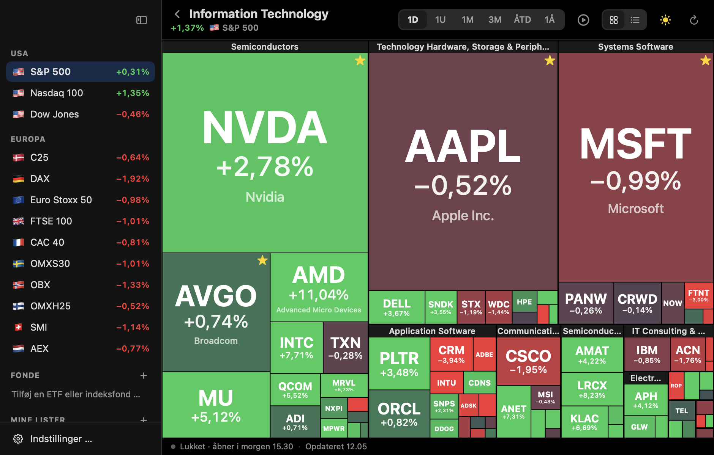 | 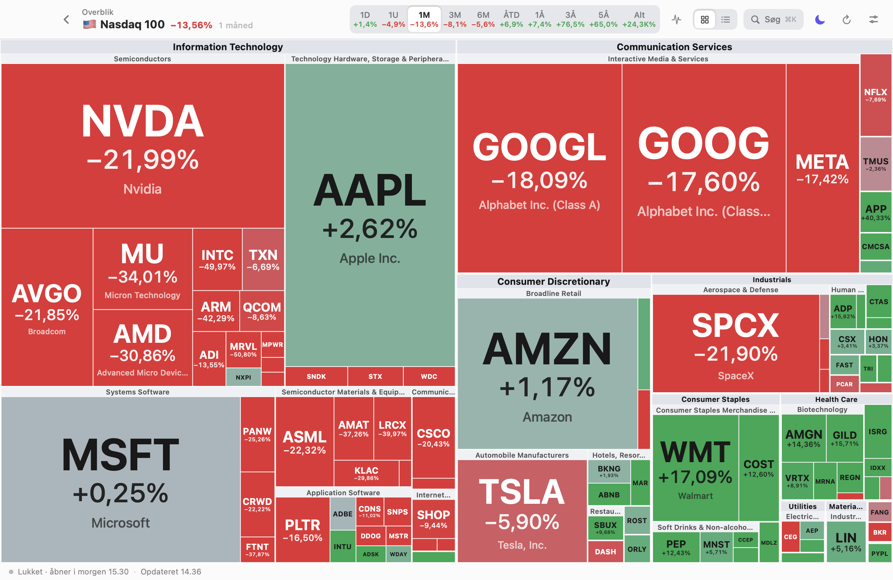 |
| En sektor, efter klik på dens strimmel | Nasdaq 100 over en måned, lyst tema |
| 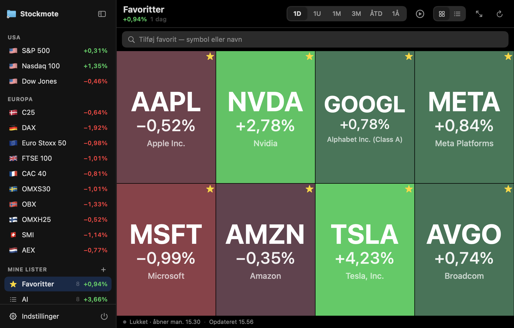 | 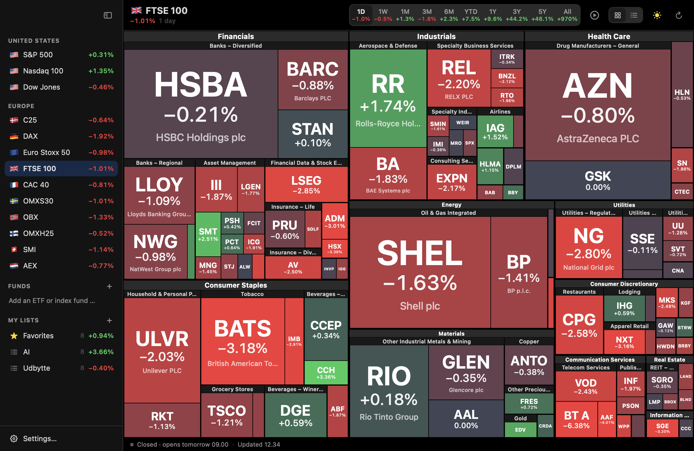 |
| Favoritter | FTSE 100, engelsk |

## Licens

[MIT](LICENSE). Du må bruge, ændre og videregive koden, også kommercielt, så længe copyright-linjen og licensteksten
følger med. Stockmote har ingen tredjepartsafhængigheder. Kurser og indekslister tilhører deres kilder (Yahoo
Finance, Nasdaq, Wikipedia og indeksudbyderne) og er ikke omfattet af licensen.
