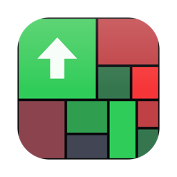

# Stockmote

**English** · [Dansk](README.da.md)

A macOS app — a window and a menu bar item — that shows the stock market as a heatmap: three US indices and ten European ones, from the S&P 500
to the Danish C25 and the German DAX — and any ETF or index fund you search for, shown stock by stock. Your own lists
hold any mix of stocks, funds and indices, so a list can stand for a portfolio.

**This app was written by a machine intelligence.** All the code, the comments, the design, the icon, the scripts and
this README were made by Claude Opus 5.5 (Anthropic) from a human's description. No human has reviewed the code line by
line. Read the [Disclaimer](#disclaimer) before you trust it with anything.

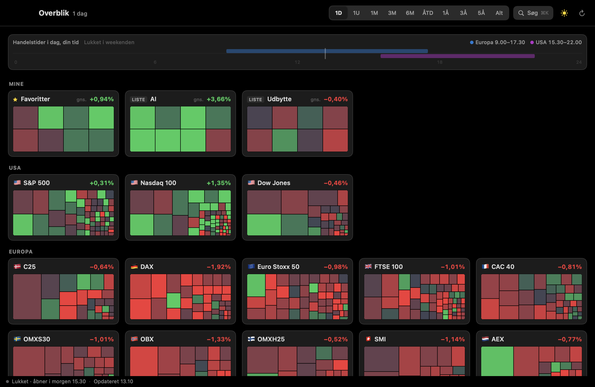

It is an ordinary Mac app with one window you can resize, minimise and put in full screen, a Dock icon — and an icon
in the menu bar that brings the window forward from anywhere. Each tile is a company; its
size is the market value and its colour is how much the stock has moved in the time range you picked. It opens on an
**overview** of every market and list; a click goes into a map, and a click on a tile into the stock itself.

The app speaks Danish and English; pick the language in settings. This README uses the English labels.

Apple frameworks only: SwiftUI, AppKit, WidgetKit and AppIntents. No third-party dependencies. Requires macOS 14 or
later.

## Disclaimer

Not investment advice. The app shows public quotes as they are. It is not made by or affiliated with Nasdaq, Yahoo,
S&P Dow Jones Indices, Nasdaq Copenhagen, Deutsche Börse, BlackRock, Vanguard, DWS, Amundi, State Street, Invesco, Nordnet, Morningstar or any other exchange, index
or fund provider.

Quotes come from public endpoints at Yahoo Finance and Nasdaq, fund holdings from BlackRock (iShares), Vanguard,
DWS (Xtrackers), Amundi, State Street, Invesco and Nordnet, NAV prices for unlisted funds from Morningstar, none of which need an account or API key. None of them is a
documented, promised API. Any of them can change or close without notice, and then the map goes grey and the status
line says which source failed. No analytics and no tracking.

**Every figure is read from real prices.** When there isn't one — a stock listed after the range began, an index
whose history Yahoo doesn't have that far back — the app shows **–** rather than a number worked out some other
way. Two derived figures are shown because they are customary, and each is named where it appears: a fund's
**indicative** value for the day (≈, see *Prices for Danish and Nordnet funds*) and the **average** of a list or
sector. A list's average is of each item's own figure — a stock's, a fund's own price, an index's own figure — and
an indicative value is not averaged in.

## Features

- **A real Mac window.** Traffic lights in the toolbar row, a transparent title bar level with the toolbar, resizing
  from every edge (down to 720 × 480), the green button for macOS full screen in its own Space, minimise to the Dock,
  zoom, and the size and position remembered between launches. Drag the empty part of the toolbar row to move the
  window; double-click it to zoom.
- **One window, opened from the menu bar.** A click on the menu bar icon brings the window forward — opening it if
  it is closed or minimised, and switching to it from whatever app you are in. A click while the window is already
  in front closes it again; the app keeps running. Right-click (or ⌃-click) the icon for **Open Window**,
  **Settings…** and **Quit Stockmote**. In Map Only the icon leaves Map Only.
- **Dock, menu bar or both.** Settings → **Show Stockmote in**: **Dock and menu bar** (default), **Menu bar only**
  (no Dock icon and no menu bar of its own; the window opens from the menu bar icon, and its right-click menu quits)
  or **Dock only** (no menu bar icon). Never neither. Closing the
  window does not quit — the app stays in the menu bar or the Dock, and clicking the Dock icon brings the window back.
  ⌘Q quits. The window opens at launch (**Open window at launch**, on by default), but not when Stockmote opens at
  login: then it waits quietly in the menu bar.
- **Menus.** Stockmote (About, Settings… ⌘,, Hide, Quit), File (Open Window ⌘O, New Watchlist ⌘N, Search… ⌘K,
  Close Window ⌘W), Edit, View (the ten time ranges on ⌥⌘1 … ⌥⌘9 and ⌥⌘0, Show as List ⌘L — Show as Lines on the
  overview —, Overview ⌘0, Trading
  Hours on Overview, Back ⌘[,
  Seismograph ⌘P, light/dark ⇧⌘T, Refresh ⌘R, Map Only ⇧⌘F, Enter Full Screen ⌃⌘F), Window and Help (the keyboard
  shortcuts). The menus follow the app's language, not the system's.
- **The overview** is the start screen, in three sections: **Mine** (one card per list), **United States** and
  **Europe**. Each card has the name, the change for the chosen range — the index's own figure, or a list's average
  marked *avg.* — and a small map: an index's largest stocks, or a list's items, each coloured by its own change.
  Click a card to open its map. Hover a list for a small ✕ to delete it (or right-click: rename, delete); a toast
  offers **Undo**. With no lists, Mine says to search (⌘K) and add with **+ List**.
- **Maps or lines** (the two buttons beside the clock on the overview, or ⌘L there; remembered): with **lines**
  each card shows its course over the range instead of its small map — Yahoo's closes as a percent change from the
  price the range starts from (the dashed line), green or red by where it ends. A list's line is the equal-weight
  average of its items' lines, marked *avg.* as its figure is. Tick a card (or ⌘-click it) to **compare** it: up to
  six lines in their own colours (none green, red, blue or orange, which mean up and down) on one axis above the
  cards, all at 0 % at the start of the range and each in its own market's currency. Pointing reads every line at
  that moment; ✕ on a line's label takes it out. A line whose market is closed while another trades — a holiday,
  or the US before New York opens — holds its last close there: the line goes on, flat and dashed in a lighter
  shade, as a line drawn through rather than traded on. Daily and longer closes are matched by date, so a European
  and a US close on the same day sit at the same point, and every line leaves from 0 % at one shared point,
  **Start** (each market's own close before the range is on its own day). 1W is compared in daily closes — within
  the day Europe and the US share only two hours, and the lines would mostly be held — while the cards keep their
  half-hours. 1D is the day in 5-minute closes; when one market's latest session is yesterday's, the axis gives
  the weekday.
- **Trading hours** (the clock in the toolbar on the overview, or View → Trading Hours on Overview; off until you
  turn it on, and remembered): a band over the overview with today's sessions in your own time (Europe 9.00–17.30
  and the US 15.30–22.00 seen from Denmark) and a marker for now. On Saturday and Sunday — in each exchange's own
  time zone — a session is only a faint dashed outline, the legend says *closed*, and the band says when each opens
  again ("Closed for the weekend · Europe opens Mon 9:00, USA opens Mon 15:30"). Holidays are not known: the app
  draws a holiday as a normal day rather than guess.
- **The map** fills the window. The toolbar has a back chevron and the way back as a breadcrumb you can click
  (`Overview › S&P 500 › Information Technology › Semiconductors`, or through a list:
  `Overview › My portfolio › VWCE › Information Technology`), the title and its change, the period picker, the
  seismograph, map/list and **Search ⌘K**.
- **13 indices.** United States: S&P 500, Nasdaq 100, Dow Jones. Europe: 🇩🇰 C25, 🇩🇪 DAX, 🇪🇺 Euro Stoxx 50,
  🇬🇧 FTSE 100, 🇫🇷 CAC 40, 🇸🇪 OMXS30, 🇳🇴 OBX, 🇫🇮 OMXH25, 🇨🇭 SMI and 🇳🇱 AEX. ⌘1 … ⌘9 jump to the first nine, ⌘0 to the overview.
- **Search** (⌘K, the button in the toolbar, or /) is the one way to find and add things. The results come in three
  groups: **Indices**, **Stocks** and **Funds**. Every row has **+ List** — a menu of your lists with a tick where it
  is already, and *New list with …* — and, when a list is on screen, **+ <list>** (**✓ <list>** takes it off
  again; Return adds to that list). Indices and stocks have **Open**. ↑ ↓ choose, Esc closes. **+ New watchlist** at
  the bottom makes a list and opens it.
- **Lists** are your own maps: any mix of stocks, funds and indices — a watchlist, or a portfolio (no quantities or
  weights, just the securities). Each item is one tile, all the same size, coloured by the item's own change: the
  stock's, the fund's own price (or NAV, with the indicative day marked ≈), the index's own figure — or grey with
  **–** when there is none, never a stand-in. A click on a stock opens its page, on a fund its holdings map, on an
  index its map; the breadcrumb then runs through the list (`Overview › My portfolio › VWCE › Information
  Technology`) and the chevron and Esc lead back to it. The list's figure is the equal-weight average of its items'
  own figures, marked **average**. Add with **+ List** in the search, on the stock page or in a tile's right-click
  menu; right-click a tile in a list to remove it (with Undo). Right-click a list's card → **Rename …**; ✕ or
  right-click deletes it (with Undo). There are no favourites any more: on the first launch after that change, the
  favourite stocks and the funds that were added under Mine move once into a list named **Favoritter**, and the old
  storage is removed.
- **Funds.** Type the name or ticker of an ETF or index fund in the search (`SPY`, `VWCE`, `XDWD`, `iShares Core
  MSCI World`, `SPIC25`, `Nordnet Danmark Indeks`) and put it in a list with **+ List** or **+ <list>**. Its holdings
  are loaded first, with a preview such as "237 stocks · largest: Taiwan Semiconductor 8.81%", so it can be opened as
  a map from the list. A bond, money market or multi-asset fund goes in the list too, with its own price, but it
  has no stock map: its tooltip says so, and a click says it holds no stocks instead of opening an empty map. So does
  a fund whose holdings no source has. The fund is shown
  exactly like an index — sector → industry → stock, zoom, hover, list, seismograph, full screen, widget — but each tile's
  size is the stock's **weight in the fund**, not its market value. The title shows the fund's own name and its own
  price change. Hover shows the weight, the list has a weight column, and the status line says where the holdings
  come from, and for Vanguard, which publishes monthly, their date ("Holdings from Vanguard as of Sep 30"). Large funds (iShares Core MSCI World: ~1,200 stocks) are cut to the 500 largest by weight, and the status
  line says so. Danish investeringsforeninger and the funds Nordnet sells are found too (see *Where the data comes
  from*).
- **Ten time ranges** in the segmented control at the top: 1D, 1W, 1M, 3M, 6M, YTD, 1Y, 3Y, 5Y and All (in Danish
  1U, ÅTD, 1Å, 3Å, 5Å and Alt). Under each one stands the change of what you are looking at over that range — the
  index's own figure, the fund's own price, a list's average — so you can compare the ranges without clicking
  through them; "–" while it loads or when there is no price that far back. Hover a range for where the figure is
  measured from. **3Y** runs from the close on or just before the same day three years ago. **All** runs from the
  first price Yahoo has: the title says the year ("Since 1927" for the S&P 500), and since every stock has its own
  first price — Apple 1980, Airbnb 2020 — the status line says so, and each tile's tooltip gives its date. A stock
  without a price for the whole range (listed later) stays grey instead of being measured over a shorter span, and
  the status line counts them. Large changes keep short labels: `+9,439%`, `+41.7K%`, `+1.1M%`. The colour scale
  follows the range: full colour at ±3 % for a day, 20 % for six months, 35 % for a year, 50 % for three and 80 %
  for five. For All it is logarithmic — full green at ×100, full red at −90 % — since the changes since the first
  price run from −90 % to +500,000 % and on a straight scale every tile would be full colour.
- **Sectors and industries.** Click a sector or industry header to go into it. The title becomes that level, and the
  breadcrumb above it leads back up (`Overview › 🇩🇰 C25 › Health Care`); the chevron and Esc go up one level, and
  from the top of a map to the overview.
- **Zoom.** Pinch on the trackpad (or ⌘-scroll) to zoom where the pointer is; two-finger scroll or drag to move.
  Small tiles get their labels as they grow.
- **Seismograph** (the waveform in the toolbar, ⌘P, or space on a map): a drawer under the map with one stripe per
  child of the level you are on — the sectors of an index, the industries of a sector, the stocks of an industry or a
  list (the twelve largest; six in a low window) — and a total row on top. Each column is one step of the range: the
  trading day in 5-minute steps, a week in half hours, months and three years day by day, one and five years week by
  week, All month by month (or by quarter for long histories), at most 400 steps. Each cell is coloured by that
  row's change at that moment. The total row is the index's or fund's own series (a list's average, marked as such);
  an index whose own history is missing gets an empty row rather than a stand-in. Sector and industry rows are the
  members' changes weighted by market value (by the fund's weights in a fund), marked *avg.*. The button and ⌘P open
  it paused on the latest moment; space on a map opens it and plays at once. Drag the cursor, press
  ← → to step or space to play and pause, at 1×, 2× or 4×; the map, the title and the tooltip's price follow the
  moment. Click a row's name to go into it (a stock row opens the stock). Tile sizes stay put; only the colours move.
  In Map Only it plays in a loop, like a living picture of the market.
- **Full screen** (⌃⌘F or the green button): the window in macOS full screen, toolbar and all, in its own
  Space.
- **Map Only** (⇧⌘F): the map alone, edge to edge, with no Dock, title or frame; the menu bar
  hides and slides in only if you push the pointer to the top. Hover, click and zoom still work. Esc first zooms out,
  then goes up a level, then leaves. ⇧⌘F, the menu bar icon or **Exit Map Only** in the
  right-click menu leave at once. On a MacBook with a notch the map starts below the notch, and the strip beside it
  shows the title, the change and the clock of the moment shown.
- **Hover** a tile for price (in its own currency), market value, sector, industry and the change.
- **Click** a tile (or a row in the list) to open the **stock page**: price and change for the range, a candlestick
  chart of the range from Yahoo's own open, high, low and close (5-minute candles for a day, half hours for a week,
  days up to the year to date, weeks for one, three and five years, months for All) with volume underneath and the
  candle's open, high, low, close and move shown as you point; if Yahoo has no candles, the page says so. **Lys |
  Linje** (Candles | Line) above the chart switches to a line through the same closing prices, with the close shown as
  you point; the choice is remembered. Key figures
  are only those the app has: market value, the weight in the fund you came from, the 52-week range of daily closes,
  the day's change, sector, industry, exchange and symbol. **Same industry** is a small map of its peers (click one
  to go to it), **Also in** lists the indices it is in, your lists that hold it and the funds in your lists that
  hold it, **+ List** (with *New list with …*) adds it, and **Open on Yahoo Finance** (or the site chosen in
  settings, in the chosen browser) is the one way out to the web. **Right-click** a tile for the stock page, the web,
  your lists, its sector or industry, or copying the symbol. A sector's or industry's figure is weighted by market
  value (by the fund's weights in a fund).
- **List view** (⌘L): any map as a sortable list.
- **Light and dark theme**, switched with the sun/moon button in the toolbar (⇧⌘T; right-click to follow the system). The light theme is not the dark one inverted: white grout between the tiles, light grey
  for unchanged stocks and dark text wherever a tile is light.
- **Danish or English**, switched instantly without a restart. Numbers follow: `+0,31%` and `1,2 bio. $` in Danish,
  `+0.31%` and `$1.2T` in English.
- **Menu bar** shows the chosen index's change today next to the icon, both in green or red (or blue/orange).
- **Widget** for the desktop and Notification Centre in all four sizes: one of your lists — its stocks, funds and
  indices, each by its own change, with the average marked *avg.* — or an index, fund, sector or industry, in any
  time range. A fund priced by its daily NAV shows – for the day. It follows the theme chosen in settings (system,
  light or dark). Clicking it opens the window on the matching view — a list widget on that list.
- **Everything that switches on also switches off** with the same click or key: the menu bar icon closes the window
  it brought forward (and Map Only), ⌘P the seismograph, ⌘L map/list (maps/lines on the overview), ⌃⌘F full screen, ⇧⌘F Map Only, the clock the
  trading hours, and **✓ <list>** in the search takes the stock, fund or index off the list.
- **Esc** closes a dialog, then zooms out, then closes the seismograph, then goes up a level: stock → map → sector →
  index or fund → the list it was opened from → overview. It never closes the window.
- **Narrow windows.** In a narrow window long titles are shortened with … and the time-range control, with its
  figures, becomes a compact menu that lists each range with its change, so nothing is pushed out of the window.
- **Settings** (the two sliders at the right end of the toolbar, ⌘, or **Settings…** in the Stockmote menu or the menu bar icon's right-click menu opens the standard Settings window): theme, colours
  (red/green or orange/blue for red–green colour blindness), language, Dock and/or menu bar, what the menu
  bar shows, open window at launch, launch at login, refresh rate, which site and browser stocks
  open in.

| | |
| --- | --- |
| 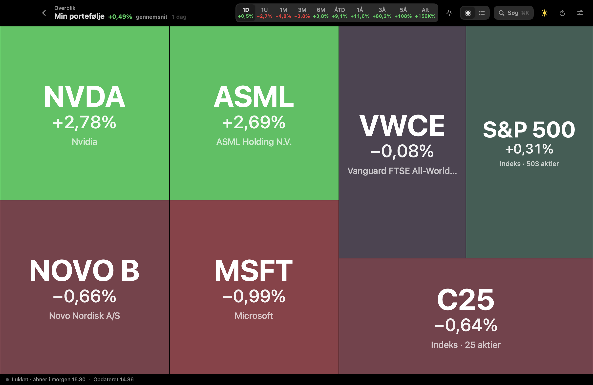 | 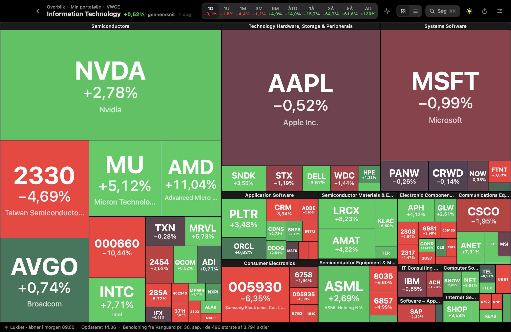 |
| A list as a portfolio: stocks, a fund and two indices, each by its own change | The fund opened from the list, then its Information Technology sector |
| 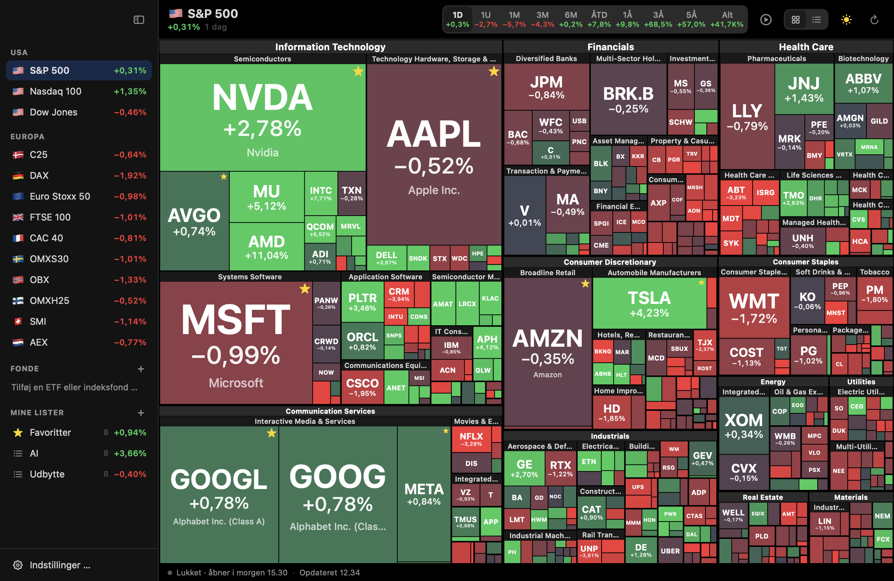 | 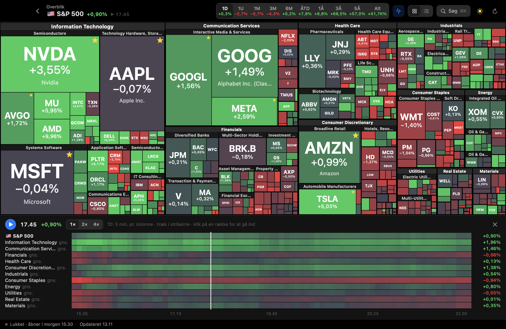 |
| The S&P 500's map, one day | The seismograph under the S&P 500: one stripe per sector, the cursor in the afternoon |
| 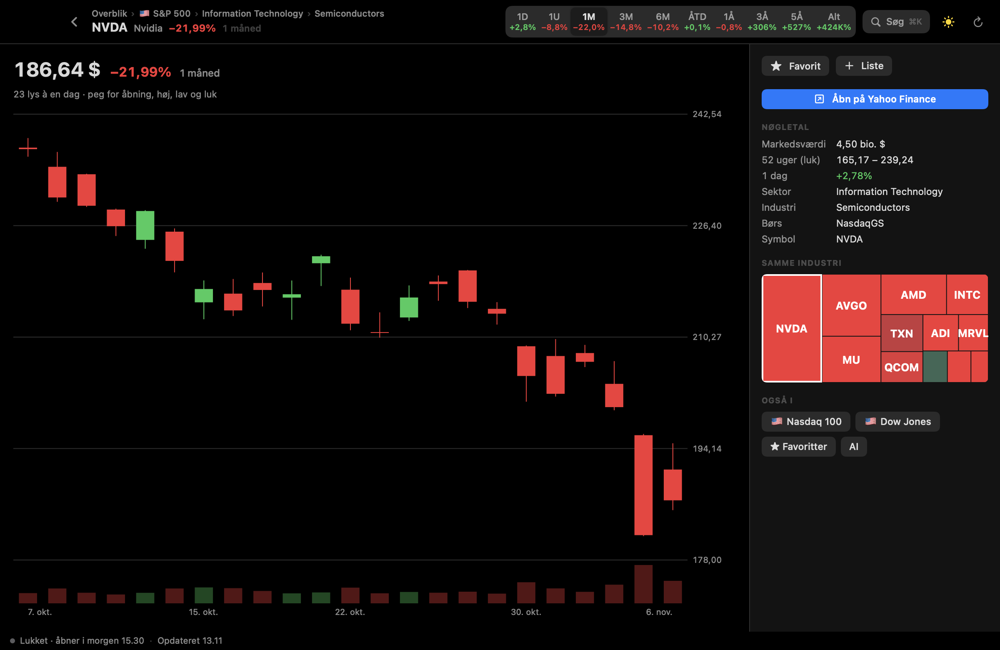 | 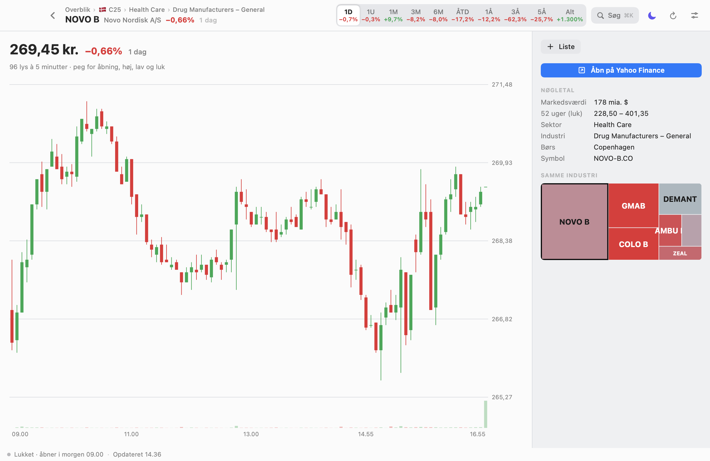 |
| A stock page: one month of daily candles | Opened from the C25, in the light theme |
| 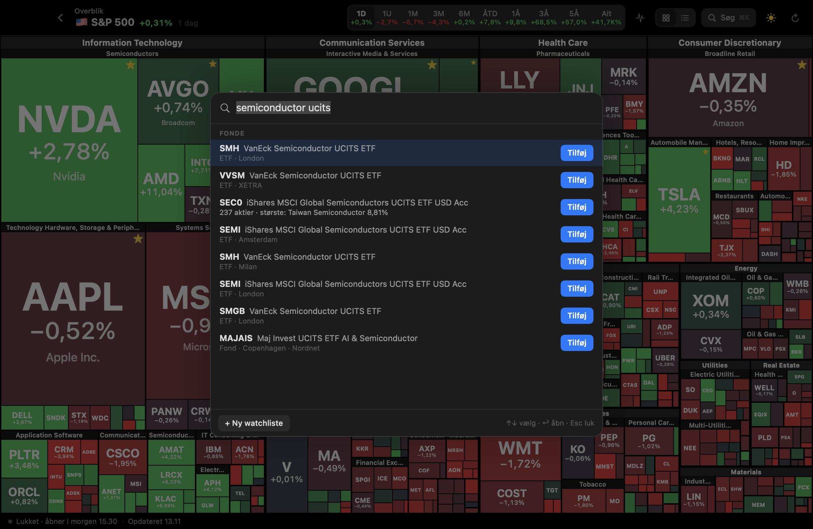 | 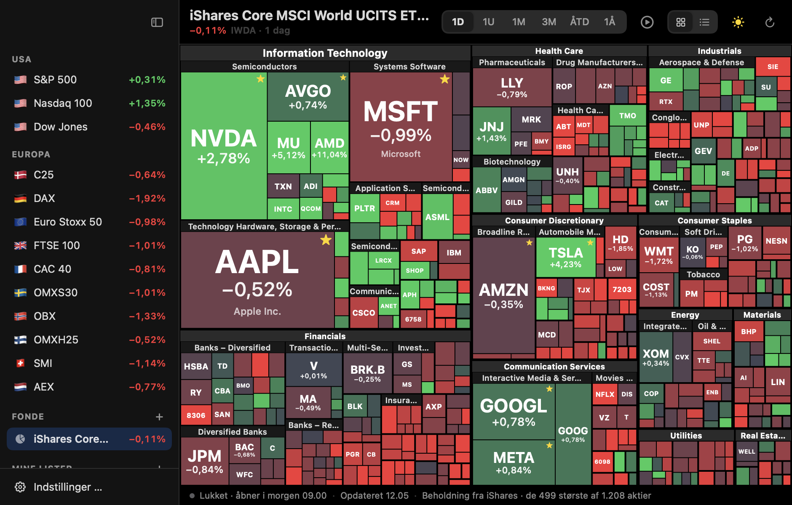 |
| The search with a list on screen: **+ List** and **+ Min portefølje** on every row, a fund's holdings loaded | A fund: iShares Core MSCI World, tiles sized by weight |
| 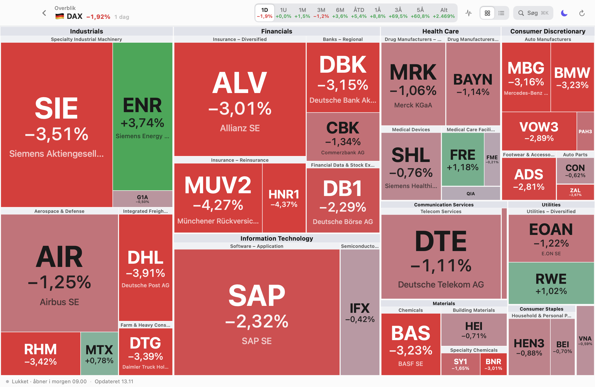 | 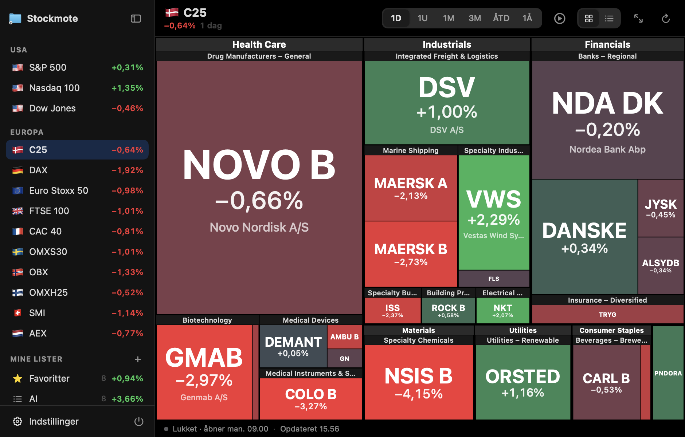 |
| DAX, light theme | C25 — Danish stocks in Danish kroner |
| 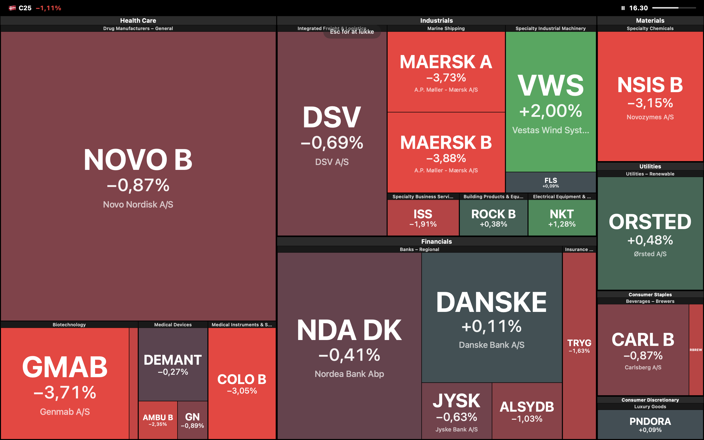 | 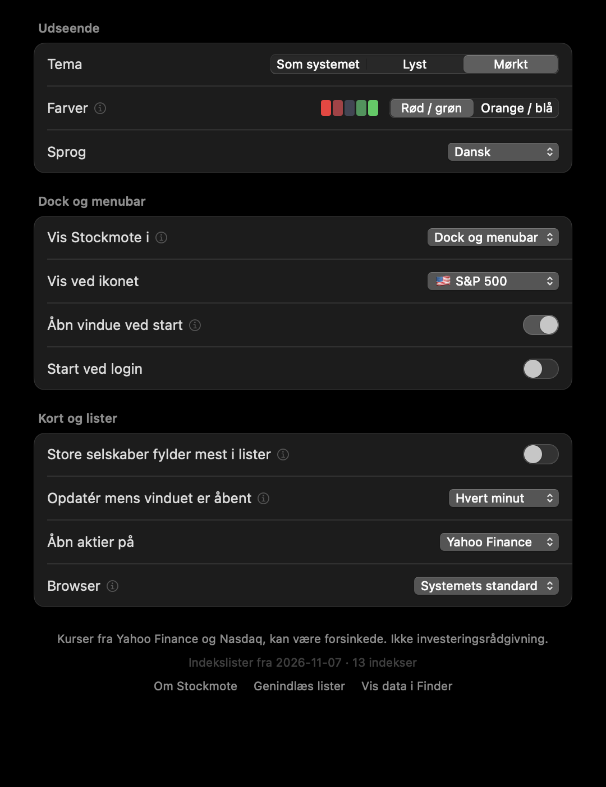 |
| Map Only with a notch: C25 playing at 14.30 | The Settings window |

## Build

```bash
swift build
swift run Stockmote
```

## Make the .app bundle

```bash
./Scripts/make-app.sh --install --open
```

This builds release, packages `build/Stockmote.app` with the widget inside as `Contents/PlugIns/StockmoteWidget.appex`,
signs both ad hoc and, with `--install`, copies the app to `/Applications` (quitting a running copy first).

The widget appears in the gallery once the app is in `/Applications` and has been opened once: right-click the desktop
→ **Edit Widgets** → search for Stockmote.

## Where the data comes from

| What | Source | How often |
| --- | --- | --- |
| Price and change, all ranges, all indices | Yahoo Finance `v7/finance/spark` | Every minute while the window is open and a market is open; every 5 min otherwise; every 30 min when all are closed |
| History for the seismograph | The same endpoint with `interval` set (5m, 30m, 1d, 1wk or 1mo) | When you open the seismograph, and again if you change index, list or range |
| Candles on the stock page (open, high, low, close, volume) and the 52-week range | Yahoo Finance `v8/finance/chart`, one symbol per call | When you open a stock page or change range there; at most every 5 min |
| Exchange rates (for sizing European stocks in dollars) | Yahoo Finance, `EURUSD=X` and friends | With the prices |
| US market value, name, search | Nasdaq screener (all ~7000 US stocks, 2 MB) | Every 30 min |
| Index members, sectors, European market values | `Indices.json`, bundled | When you run `update-indices.sh` |
| Fund search; sectors for foreign stocks in funds | Yahoo Finance `v1/finance/search` | As you type; once per new stock |
| Fund holdings: iShares ETFs, US and European (SOXX, IVV, SEC0, EUNL, CSPX …) | iShares' product lists (the ones the product screener on ishares.com loads, for the US, UK and German sites) and each fund's `latest-holdings.csv` | When the fund is added, then at most weekly; the product lists weekly |
| Fund holdings: SPDR ETFs (SPY, XLK, SPGM …) | State Street's daily spreadsheet (`holdings-daily-us-en-<ticker>.xlsx`) | When the fund is added, then at most weekly |
| Fund holdings: Invesco ETFs (QQQ, RSP …) | Invesco's JSON (`dng-api.invesco.com`) | As above |
| Fund holdings: Vanguard US funds (VOO, VTI, VT …) | The JSON behind investor.vanguard.com's fund pages (`irr/funds/profile/<ticker>-AdditionalFundData`) | As above; Vanguard updates monthly, a few weeks after month end |
| Fund holdings: Vanguard UCITS ETFs (VWRL, VWCE, VUSA …) | vanguard.co.uk: the fund ids from the product page's model (`product.model.json`), names, ISINs and tickers of every listing, and the holdings from its GraphQL service (`gpx/graphql`) | As above; the product list weekly |
| Fund holdings: Xtrackers ETFs (XDWD, XMME, XDAX …) | etf.dws.com: the fund pages in the sitemaps (ISIN and name) and the holdings JSON behind each page (`api/pdp/en-gb/etf/<ISIN>/holdings`) | As above; the sitemaps weekly |
| Fund holdings: Amundi and ex-Lyxor ETFs (MWRD, CW8, PANX …) | amundietf.co.uk's product API (`mapi/ProductAPI/getProductsData`): the product list (UK and French sites) and each fund's composition | As above; the product list weekly |
| Fund search and holdings: Danish investeringsforeninger (DKIDKIX, SPIC25KL …) and funds sold by Nordnet (Nordnet Danmark Indeks, Nordnet Global Indeks …) | Nordnet's public API behind nordnet.dk (header `client-id: NEXT`, no account): `api/2/main_search` for the search, `api/2/instruments/<id>/fund/info` for the largest holdings with weights, `api/2/instruments/<ids>` for their ticker, exchange and ISIN | As you type; holdings when the fund is added, then at most weekly |
| Daily NAV for funds that are not listed (Nordnet's own funds and others Yahoo doesn't know) | Morningstar's public price series (`lt.morningstar.com/api/rest.svc/timeseries_price`, by Morningstar id, in the fund's currency) | With the prices for 1U and longer ranges |
| Stock symbols for funds that write ISINs (Vanguard, Xtrackers, Amundi) | Yahoo Finance `v1/finance/search` with the ISIN | Once per new stock |

**Nasdaq's screener lags.** Measured on a Friday afternoon it still showed Thursday's close, so it is used only for
size and search, and the market value is scaled by Yahoo's current price. Yahoo allows 20 symbols per call, so the
S&P 500 costs 26 calls, four at a time.

**European market values** come from Yahoo's fundamentals series in local currency, stored with the price at the
time. The app scales them by today's price and converts them to dollars, so a map with both Novo Nordisk and Eli
Lilly (the stock page's *Same industry*) gets fair sizes.

The **index figure** at the top, on the overview and under each range is the index's own (`^GSPC`, `^OMXC25`,
`^GDAXI` …). If Yahoo does not answer, it shows –: an average of the members would not be the index's figure.

**As close to the exchange as possible.** Where the exchange shows an index's day openly, the day comes from there:
**C25, OMXS30 and OMXH25 from Nasdaq Nordic**, and the **Nasdaq 100 from Nasdaq** — the 1D price, previous close and
minute prices, put in 5-minute bars like Yahoo's, with the line ending on the latest price. Yahoo's `^OMXC25` had
returned Friday's afternoon as Monday's series, with a previous close a day too old: +0.14 % for a day Nasdaq put at
+0.81 %. The other indices' owners (S&P Dow Jones Indices, Deutsche Börse and STOXX, FTSE Russell, Euronext, SIX)
sell their data, so those, and every range longer than a day, are Yahoo's. Every 1D figure from Yahoo is checked: a
day whose series has no price from the date Yahoo says the symbol last traded is not used. If an exchange does not
answer, Yahoo's figure is used under that check. Pointing at a figure says where it came from (*Source: Nasdaq
Nordic*, *Yahoo Finance* or *Morningstar*).

**How each range is measured.** Yahoo's `chartPreviousClose` is the close just before the range starts, for every
range it names (`5d`, `1mo`, `3mo`, `6mo`, `ytd`, `1y`, `5y`). With `max` it is the first price Yahoo has — checked:
17.66 for the S&P 500, its price at the end of 1927. Yahoo names no three-year range (`3y` happens to be accepted,
but isn't among the ranges it lists), so **3Y** reads the daily closes over five years and takes the last one
before the moment three years ago; if the series doesn't reach that far, or has a gap of more than ten days there,
there is no figure. The figures under the ranges cost one small call per range, for the index or fund alone; the
members are only fetched for the range you have chosen. A symbol whose first trade is after the range began gets no
figure for it. Yahoo's base is also checked against the series it came with: for a few symbols it is simply
yesterday's close whatever the range (Oslo's OBX.OL gave −1.33 % for one year, five years and All alike), so a range's
figure is only used when the series starts at the range's start and its first close is within ×1.5 of the base (×4
for All, whose first bar is a month or a quarter, often just after a listing).

**Tiles are sized by market value in every index.** The real Dow Jones is price-weighted, but a map where the size is
the share price says little.

**Sectors.** US stocks use GICS. European stocks use Yahoo's classification, mapped to the GICS sector names so every
index shares one vocabulary; their industries keep Yahoo's names (`Drug Manufacturers – General`).

**Funds.** No open source has the holdings of every fund. The app tries, in this order:

1. **The fund's own holdings** at iShares (US and European iShares ETFs), Vanguard (US funds and UCITS ETFs),
   Xtrackers, Amundi (including the former Lyxor funds), State Street (every SPDR ETF) or Invesco.
   An iShares fund is found in iShares' own product lists by ticker — any listing: `SEC0` on Xetra, `SEMI` in
   London — or else by name, since the lists have one ticker per country (`IWDA` in Amsterdam is found as "iShares
   Core MSCI World UCITS ETF", the same fund as `SWDA` and `EUNL`). All three publish the full holdings with weight,
   ticker and trading currency; iShares also gives the exchange and the sector. Vanguard's UCITS funds are found by
   any listing's ticker (`VWRL`, `VWRA`, `VWCE` are all the same product list), Amundi's by ticker or name, and
   Xtrackers' by name, since DWS publishes no tickers. Vanguard and Amundi write ISIN and ticker (Amundi as Bloomberg
   tickers with the exchange: `ASML NA` → `ASML.AS`), Xtrackers only the ISIN.
2. **One of the app's own indices**, if the fund's name says it tracks one: `iShares Core DAX`, `Sparindex INDEX OMX
   C25 KL`, `Vanguard 500 Index Admiral`. The holdings are then the index members, and tiles are sized by market value.
3. **A SPDR fund on a similar index**: MSCI World, MSCI ACWI and FTSE All-World → SPGM (MSCI ACWI IMI); emerging
   markets → SPEM; Europe/STOXX 600 → SPEU; the whole US market → SPTM. The status line says so ("Holdings of SPGM
   (SSGA), which tracks a similar index"). MSCI World leaves out emerging markets, so this is an approximation — the
   largest stocks are the same.
4. Otherwise: "Could not load the holdings for …".

Before all of this, a **Danish fund or one sold by Nordnet** gets its holdings from Nordnet: a fund from Nordnet's
search carries Nordnet's id, and a Copenhagen-listed fund found in Yahoo's search (`DKIDKIX.CO`) is looked up in
Nordnet's search by ticker. Nordnet publishes only the **25 largest holdings** (Morningstar's data, usually from the
last month end). When they cover less than 95 % of the fund and the name matches step 2 or 3 (Nordnet Global Indeks →
SPGM), the stand-in is preferred because it shows the whole fund; otherwise the map shows the 25, and the status
line says so ("Holdings from Nordnet as of Oct 30 · only the fund's 25 largest holdings"). Expired index futures and
cash in Nordnet's list are left out.

**Prices for Danish and Nordnet funds.** A listed investeringsforening has a Yahoo symbol (`DKIDKIX.CO`) and is
priced like any ETF. A fund that isn't listed and that Yahoo doesn't know only has a daily NAV, published the
evening after: the app fetches it from Morningstar for 1W and longer — 3Y from the NAV on or just before the day
three years ago, All from the fund's first NAV — and the search result shows `NAV` instead of a ticker. For 1D there
is no NAV for today yet, so the day's change is the fund's **indicative value**, the customary iNAV: the holdings'
changes weighted by their weight in the fund. It is marked as such wherever it appears — `≈ +0.84%` with
**indicative** beside it in the title, `≈` on the overview, the period picker, the menu bar and the seismograph — and its
tooltip says it is estimated from the holdings until the NAV is published. The widget shows – instead. Yahoo knows many of
Nordnet's funds under a Morningstar id (`0P000134KA.CO` = Nordnet Danmark Indeks A); then the Yahoo result is kept,
with Nordnet's holdings.

Bond, money market and multi-asset funds (by the provider's asset class, or because their holdings contain no
stocks) stop with a message instead: they cannot be drawn as a stock map. Swap-based ETFs (Amundi's `CW8`, `500`,
`ANX` …) hold a substitute basket of other stocks, not the index, so the app skips their basket and goes on to step 2
and 3; without a stand-in it says the fund is swap-based.

| Provider | Supported | Why / how |
|---|---|---|
| iShares, Vanguard, Xtrackers, Amundi/Lyxor, SPDR (US), Invesco (US) | Yes | Full holdings, see above |
| SPDR Europe (UCITS), WisdomTree, VanEck, HSBC, J.P. Morgan, Franklin Templeton, Global X, Schwab, First Trust, Fidelity | Not yet | Not researched yet; funds on a known index get a stand-in |
| Danish investeringsforeninger (Sparindex, Danske Invest, Nykredit Invest, Jyske Invest, BankInvest …) and funds sold by Nordnet | Yes, top 25 | The 25 largest holdings from Nordnet; a stand-in when the fund tracks a broad index the app knows (see above); NAV from Morningstar for unlisted funds |

Funds with a twist in the name — sector, factor, ESG, leverage, bonds — do not track the broad index and get no
stand-in. Zacks and stockanalysis.com were tried and left out: they turn away anything but a browser.

Foreign stocks in a fund get their Yahoo symbol from ticker and exchange where the provider names the exchange, as
iShares does (`ASML` on Euronext Amsterdam → `ASML.AS`, `000660` on the Korea Exchange → `000660.KS`), and otherwise
from ticker and currency (`7203` + JPY → `7203.T`, `700` + HKD → `0700.HK`, `SHEL` + GBP → `SHEL.L`). Euro stocks
without an exchange cannot be guessed (Paris, Frankfurt, Milan …) and are looked up by name, and so are stocks whose
guessed symbol Yahoo does not know. When the provider writes the ISIN, Yahoo's search is asked for the ISIN first,
which finds exactly the company and its primary listing. Without exchange or currency, the ISIN's country gives the
exchange (`JP…` → Tokyo, `KR…` → Korea, `CN…` → Shanghai, Shenzhen or Hong Kong by ticker); for companies registered
in Ireland, the Cayman Islands and the like, the provider's country of risk does (Linde → New York, Tencent → Hong
Kong). Sector and industry come from
`Indices.json` if the stock is there, otherwise from Yahoo's search, mapped to the GICS sector names, and as a last
resort from the fund's own file. The lookups are stored in `~/Library/Application Support/Stockmote/Funds/Names.json`,
the providers' product lists in `iShares.json`, `Vanguard.json`, `Xtrackers.json` and `Amundi.json`, and the
holdings in the same folder, so a fund only costs Yahoo calls the
first time. Yahoo answers 429 when asked too much;
the app then waits, and retries the lookups that failed one at a time.

**Opening hours** are per exchange and shown in your local time in the status line: `Closed · opens Mon 09.00`. Holidays are not known.

## Index members

```bash
./Scripts/update-indices.sh          # rewrite Indices.json
./Scripts/update-indices.sh --check  # show what changed, write nothing
```

The script ([update-indices.py](Scripts/update-indices.py)) takes about a minute:

- **S&P 500** from the `datasets/s-and-p-500-companies` list, with GICS sector and sub-industry.
- **Nasdaq 100** from Nasdaq's own list. Members outside the S&P 500 (ASML, Arm, Shopify …) have no open GICS source
  and are set by hand in `OVERRIDES`.
- **Dow Jones** from the Wikipedia template of its members.
- **The ten European indices** from the ticker table in each Wikipedia article. Sector, name and market value come
  from two Yahoo endpoints that need no cookie: the search and the fundamentals time series. Tickers where Wikipedia
  and Yahoo disagree go in `YAHOO_RENAMES` (Nordea is `NDA-DK.CO`).

Yahoo answers 429 if you run the script several times in a row. It waits and tries again; if it still fails, it stops
before writing, so the old file is left untouched.

You can override the bundled file without building: put your own `Indices.json` in
`~/Library/Application Support/Stockmote/` and click **Reload lists** in settings.

## The widget

Three things that Xcode normally does for a widget had to be done by hand, because the app is built with SwiftPM:

- **Entry point.** An extension must start in Foundation's `_NSExtensionMain`, not in `main`. Without it the process
  dies in ExtensionFoundation before WidgetKit gets going, and the widget never shows up in the gallery. The widget
  target is linked with `-e _NSExtensionMain` (see [Package.swift](Package.swift)).
- **AppIntents metadata.** The widget's settings (content, index, sector, range) must be described in
  `Metadata.appintents`. `make-app.sh` makes it with Xcode's `appintentsmetadataprocessor` from the constant values
  the compiler is asked to emit.
- **Sharing data without an app group.** A widget runs in a sandbox and cannot read the app's settings. An app group
  needs an Apple developer team, and Stockmote is signed ad hoc. Instead the app writes
  `~/Library/Application Support/Stockmote/Widget.json` (the lists with their stocks, funds and indices, indices, funds and their weights,
  sectors, market values, language), and the widget has a read-only exception for exactly that folder. Prices are not in the file: the widget
  fetches them from Yahoo itself, so it is fresh even when the app has not been opened.

It refreshes about every 15 minutes while a market is open and hourly otherwise; WidgetKit has the last word.

## Files

| File | Contents |
| --- | --- |
| [Sources/Stockmote/StockmoteApp.swift](Sources/Stockmote/StockmoteApp.swift) | `@main`, `AppDelegate` (launch, Dock / menu bar, reopen from the Dock), `stockmote://` links, snapshot mode |
| [Sources/Stockmote/MainWindow.swift](Sources/Stockmote/MainWindow.swift) | The main window and its title bar, the Settings window, Esc in the window |
| [Sources/Stockmote/MainMenu.swift](Sources/Stockmote/MainMenu.swift) | The main menu, in the app's language |
| [Sources/Stockmote/MenuBarItem.swift](Sources/Stockmote/MenuBarItem.swift) | Menu bar icon and coloured figure; a click brings the window forward or closes it, right-click gives a small menu |
| [Sources/Stockmote/PanelView.swift](Sources/Stockmote/PanelView.swift) | Toolbar with breadcrumb, status line, the map, a list's tiles, list view |
| [Sources/Stockmote/Overview.swift](Sources/Stockmote/Overview.swift) | The overview: trading hours, the cards and their small maps |
| [Sources/Stockmote/OverviewLines.swift](Sources/Stockmote/OverviewLines.swift) | The overview's lines: the cards' courses, the comparison and its colours |
| [Sources/Stockmote/StockPage.swift](Sources/Stockmote/StockPage.swift) | The stock page: candles from Yahoo's chart endpoint, key figures, peers, Also in |
| [Sources/Stockmote/Search.swift](Sources/Stockmote/Search.swift) | The search: indices, stocks and funds, and **+ List** on each |
| [Sources/Stockmote/Dialogs.swift](Sources/Stockmote/Dialogs.swift) | The dialog host, new and rename watchlist, and the fund picker that loads a fund's holdings before it goes in a list |
| [Sources/Stockmote/HeatmapView.swift](Sources/Stockmote/HeatmapView.swift) | Hover, click, zoom, tooltip, right-click menu |
| [Sources/Stockmote/Fullscreen.swift](Sources/Stockmote/Fullscreen.swift) | Map Only: the borderless full-screen map and the notch strip |
| [Sources/Stockmote/Replay.swift](Sources/Stockmote/Replay.swift) | The seismograph: history, timeline, playback, the rows and the drawer under the map |
| [Sources/Stockmote/SettingsView.swift](Sources/Stockmote/SettingsView.swift) | Settings and About |
| [Sources/Stockmote/MarketData.swift](Sources/Stockmote/MarketData.swift) | Quotes, exchange rates, refresh loop, Nasdaq screener |
| [Sources/Stockmote/Universe.swift](Sources/Stockmote/Universe.swift) | Loading `Indices.json` |
| [Sources/Stockmote/Funds.swift](Sources/Stockmote/Funds.swift) | Funds: search, holdings from iShares, State Street and Invesco, stand-in indices, foreign stock lookup, cache, .xlsx and CSV readers |
| [Sources/Stockmote/FundIssuers.swift](Sources/Stockmote/FundIssuers.swift) | Fund holdings from Vanguard, Xtrackers and Amundi, product lists, ISIN rows |
| [Sources/Stockmote/Nordnet.swift](Sources/Stockmote/Nordnet.swift) | Nordnet's public API: search for Danish and Nordnet funds, their largest holdings |
| [Sources/Stockmote/Lists.swift](Sources/Stockmote/Lists.swift) | Lists of stocks, funds and indices; the one-time move of old favourites and funds into a list |
| [Sources/Stockmote/Preferences.swift](Sources/Stockmote/Preferences.swift) | Settings |
| [Sources/Stockmote/AppState.swift](Sources/Stockmote/AppState.swift) | Overview, map or stock; the source, drill-down, back, zoom, the open dialog and the toast |
| [Sources/Stockmote/Browsers.swift](Sources/Stockmote/Browsers.swift) | Which browser links open in (from DRmote) |
| [Sources/Stockmote/WidgetSync.swift](Sources/Stockmote/WidgetSync.swift) | Writes `Widget.json` and reloads the widget |
| [Sources/StockmoteShared/Treemap.swift](Sources/StockmoteShared/Treemap.swift) | Squarified treemap layout |
| [Sources/StockmoteShared/HeatmapCanvas.swift](Sources/StockmoteShared/HeatmapCanvas.swift) | Drawing the tiles, shared by app, full screen and widget |
| [Sources/StockmoteShared/Style.swift](Sources/StockmoteShared/Style.swift) | Time ranges, themes, colour scale, number formats, window colours |
| [Sources/StockmoteShared/Lang.swift](Sources/StockmoteShared/Lang.swift) | Danish and English |
| [Sources/StockmoteShared/Market.swift](Sources/StockmoteShared/Market.swift) | Symbols, opening hours, currencies |
| [Sources/StockmoteShared/Yahoo.swift](Sources/StockmoteShared/Yahoo.swift) | Yahoo client; daily NAV from Morningstar for unlisted funds |
| [Sources/StockmoteShared/ExchangeData.swift](Sources/StockmoteShared/ExchangeData.swift) | The day straight from the exchange (Nasdaq Nordic, Nasdaq) and each figure's source |
| [Sources/StockmoteShared/WidgetShare.swift](Sources/StockmoteShared/WidgetShare.swift) | The file shared with the widget |
| [Sources/StockmoteWidget/StockmoteWidget.swift](Sources/StockmoteWidget/StockmoteWidget.swift) | The widget and its settings |
| [Scripts/make-app.sh](Scripts/make-app.sh) | Packages and signs app and widget, makes the AppIntents metadata |
| [Scripts/update-indices.sh](Scripts/update-indices.sh), [update-indices.py](Scripts/update-indices.py) | Rebuild `Indices.json` |
| [Scripts/make-icon.swift](Scripts/make-icon.swift) | Draws the app icon |
| [Scripts/make-screenshots.sh](Scripts/make-screenshots.sh) | Renders the images in `docs/` |

## Screenshots

`./Scripts/make-screenshots.sh` renders them with live data. The app has a snapshot mode for it, which keeps its
settings apart from the real app's, and its fund cache in `~/Library/Application Support/Stockmote/Snapshot/Funds/`:

```bash
.build/release/Stockmote --snapshot out.png --index c25 --period 1M --theme light --lang en
```

It renders the main window's content, 940 × 600 unless told otherwise.

Options: `--screen overview|map`, `--tab map|watchlists`, `--watchlist "AI"`, `--add-list "Min portefølje" --items
"NVDA,fund:VWCE.DE,index:c25"` (that list, with exactly those stocks, funds and indices, opened), `--open
fund:VWCE.DE` (a tile in the list on screen clicked: the fund's or index's map, opened from the list), `--stock NVDA`
(the stock page), `--chart line` (its chart as a line), `--index <id>`, `--period 1D|1U|1M|3M|6M|ÅTD|1Å|3Å|5Å|Alt`,
`--sector "…"`, `--industry "…"`, `--size small|medium|large|huge` (the window's content at 720 × 480, 940 × 600,
1140 × 720 or 1400 × 860), `--list`, `--zoom 2.5`,
`--theme light|dark`, `--lang da|en`, `--fullscreen`, `--notch 32` (full screen as on a screen
with a notch), `--seismograph 0.4` (the seismograph paused 40 % into the range), `--fund SPY` (put a fund in a list
and open it from there), `--search "MSCI World"` (the search, open with results), `--fund-pick SEC0.DE` (with that
fund picked and its holdings loaded — or the warning if none were found), `--fund-add` (and put in the list on
screen), `--dialog new-list|rename-list` (the watchlist dialogs), `--trading-hours` (the overview's trading-hours
band shown), `--lines` (the overview as lines) with `--compare "sp500,c25,My portfolio"` (those indices and lists
compared), `--figures` (every index's figure and its source, printed), `--window 1200x780` (the window's content at any size), `--settings` (the Settings window). A snapshot
draws the app's own views only: the window's title bar and traffic lights are drawn by macOS
and are not in the picture — their space at the top left is left empty, as in the window.

To check the move of old favourites and funds into a list, `--legacy-favorites "AAPL,NVDA"`, `--legacy-funds
"SPY,IWDA.AS"` and `--legacy-list "Tech:MSFT,ASML.AS"` (a list in the old format, plus one named "Favoritter")
write the old storage before the lists load; the lists are printed after the move, and `--legacy-repeat` runs it
again to show that nothing is added twice and that the old keys are gone.

| | |
| --- | --- |
| 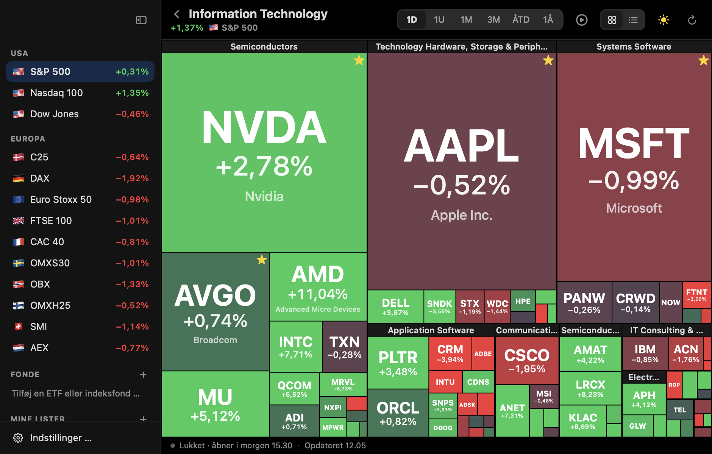 | 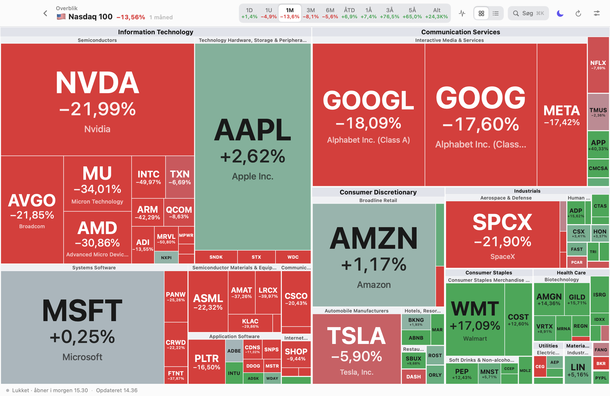 |
| A sector, after clicking its header | Nasdaq 100 over a month, light theme |
| 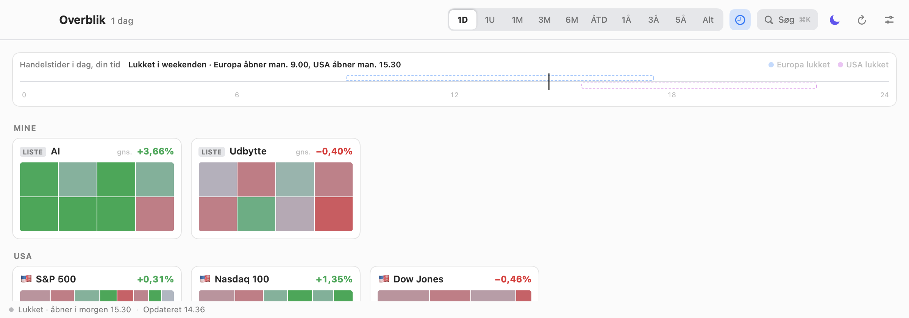 | 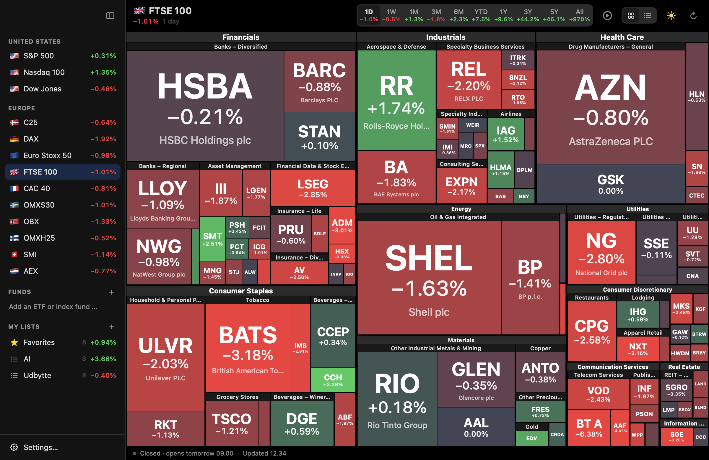 |
| The trading hours on the overview — here rendered on a Sunday, so both sessions are only outlined | FTSE 100, English |
| 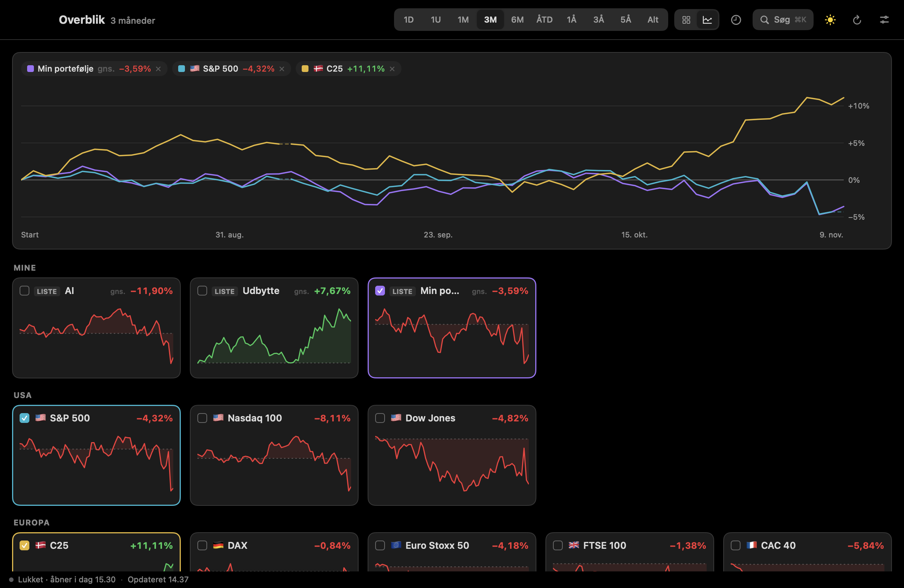 | |
| The overview as lines over three months, a list compared with S&P 500 and C25 | |

## Licence

[MIT](LICENSE). You may use, change and pass on the code, commercially too, as long as the copyright line and the
licence text go with it. Stockmote has no third-party dependencies. The quotes and index lists belong to their
sources (Yahoo Finance, Nasdaq, Wikipedia and the index providers) and are not covered by this licence.
